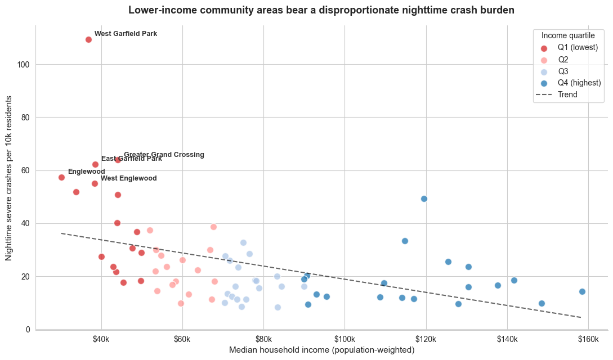
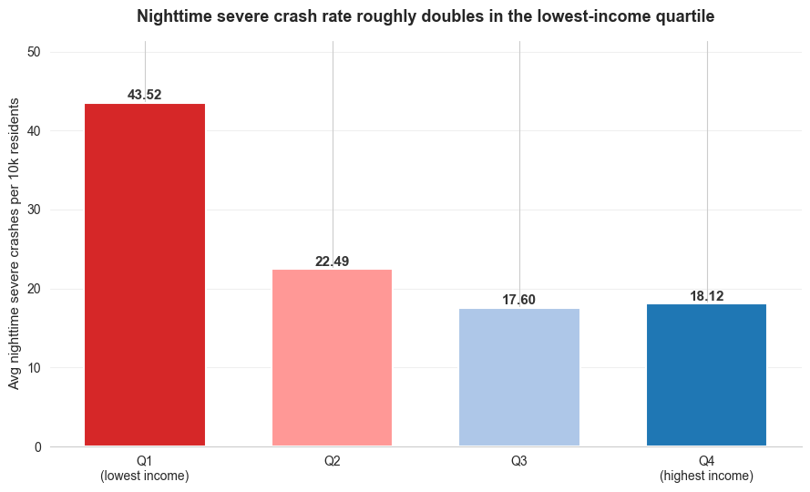
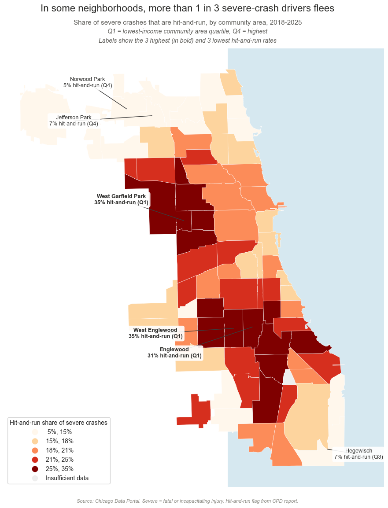

**Selected for the UMD Smith MSBA Advisory Council Day showcase.** Data pulled through the Socrata and Census APIs, joined with GeoPandas, 870,344 crashes analyzed.

Chicago has a limited budget for traffic safety. Where should it go? We pulled every crash the city has recorded since 2018, matched each one to its community area and that area's income, and checked whether severe crashes (a death or a disabling injury) are spread evenly across the city. They are not.

**Data:** Chicago Data Portal crash tables via the Socrata API (1.05M crashes, 2.30M people, 2.13M vehicles), Census ACS 5-Year 2023 tract data (1,332 Cook County tracts), and 77 community area polygons. After filtering: 870,344 crashes, 2018 to 2025.
**Course:** BUDT 758J Enterprise Cloud Computing and Big Data, University of Maryland Smith School, Spring 2026. Team of 5. Selected for the MSBA Advisory Council Day showcase.

---

## 1. Crashes in poorer areas are more often severe


Each dot is a community area, sized by how many crashes it had. In the poorest quarter of areas, 2.31% of crashes are severe. In the richest quarter, 1.60%. That is a 1.44x gap, and it goes down step by step from the poorest quarter to the richest.

## 2. At night the gap more than doubles

<p>
  
  
</p>

Night crashes are 27% of all crashes but 38% of the severe ones. Per 10,000 residents, the poorest quarter of areas has 43.5 severe night crashes; the richest has 18.1. That is **2.4x** (Welch's t-test, p = 0.0007, across 70 community areas after dropping 7 with under 10,000 residents). West Garfield Park alone is at 109.5.

## 3. Drivers flee more often where incomes are lower

<p>
  
  
</p>

In the poorest quarter of areas, the driver left the scene in 28% of severe crashes. In the richest, 18%. West Englewood and West Garfield Park are both at 35%; Norwood Park is at 5%.

## 4. Pedestrians and cyclists are a growing share, and worse off in poorer areas

- Severe crashes fell 30% from 2018 to 2025 (2,240 to 1,557), but the share that hit a pedestrian or cyclist rose from 35% to 37%
- When a pedestrian or cyclist is hit in the poorest quarter of areas, the crash is severe 19.2% of the time. In the richest quarter, 11.3%. It holds for each group on its own: pedestrians 1.44x, cyclists 1.55x

## 5. The worst intersections

We grouped crashes into 100-meter squares and kept squares with 50 or more crashes, which left 4,223 spots. After dropping long single-street stretches and keeping only real intersections, the worst is Pulaski Rd / Polk St in West Garfield Park: 14.5% of crashes there are severe, more than 8x the city median of 1.7%. West Garfield Park shows up three times in the top 12.

---

## How it was built

**Notebook 1, getting the data.** Pulled the three crash tables through the Socrata API and the Census variables through the Census API, then looked over each table with an eye on the join keys. Matched crash points to Census tracts with GeoPandas and checked a random sample against the Census Geocoder.

**Notebook 2, joins.** Kept 2018 to 2025 (the city's crash system was not citywide before late 2017), dropped 7,206 crashes with missing or placeholder coordinates, and flagged severe crashes and crashes involving a pedestrian or cyclist. The pedestrian flag comes from grouping the People table, not joining it, so each crash stays one row. Matched crashes to the 77 community areas, then rolled the tract data up to community areas: counts added up, median income weighted by population, percentages recalculated from the summed counts.

**Notebook 3, analysis.** The five findings above, plus the checks behind them: why the night analysis drops areas under 10,000 residents, why most rates are per crash rather than per person (Chicago does not publish traffic counts by community area), and why the Loop stands out.

**Limits.** Most rates are per crash, so they say how bad crashes are, not how often they happen. Community areas are big; the intersection list is the only street-level view. We planned to add speed-camera locations but did not get to it.

## Repository

```
notebooks/
  01_acquisition_and_eda.ipynb    API pulls, EDA, tract spatial join, validation
  02_joins.ipynb                  filters, flags, community area join, demographics roll-up
  03_analysis.ipynb               the five findings, with figures
figures/                          charts from Notebook 3 and Tableau
data/community_area_demographics.csv   77 rows, the demographics table Notebook 2 builds
tableau/income_vs_severe_crash.twb     the Figure 1 workbook (layout only, no data)
docs/final_report.pdf
```

**Run it:** `pip install -r requirements.txt`, set `SOCRATA_APP_TOKEN` and `CENSUS_API_KEY` in your environment, then run the notebooks in order. Notebook 1 downloads about 2 GB. The CSVs it writes are not in the repo.

**Tools:** Python (pandas, GeoPandas, SciPy, matplotlib, seaborn), Socrata and Census APIs, Tableau
