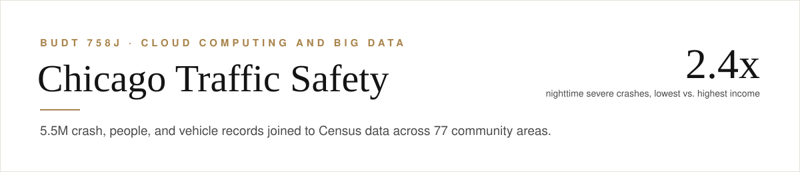
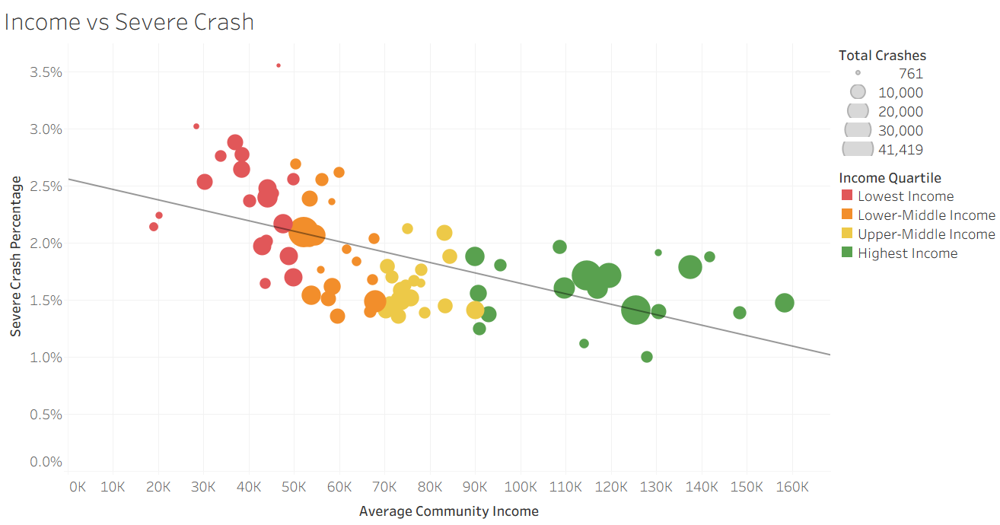
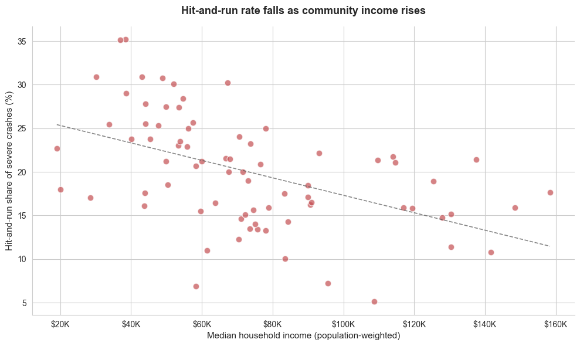

Chicago has limited money for traffic safety. Where should it go? We pulled every crash the city has recorded since 2018, attached each one to a community area and its Census income, and asked whether severe crashes (a death or incapacitating injury) fall evenly across the city. They do not.

**Data:** Chicago Data Portal crash tables via the Socrata API (1.05M crashes, 2.30M people, 2.13M vehicles), Census ACS 5-Year 2023 tract data (1,332 Cook County tracts), and 77 community area polygons. After filtering: 870,344 crashes, 2018 to 2025.
**Course:** BUDT 758J Enterprise Cloud Computing and Big Data, University of Maryland Smith School, Spring 2026. Team of 5. Selected for the MSBA Advisory Council Day showcase.

---

## 1. Crashes in poorer areas are more often severe



Each dot is a community area, sized by crash count. In the lowest-income quartile, 2.31% of crashes are severe. In the highest, 1.60%. That is a 1.44x gap, and it falls in order across all four quartiles.

## 2. At night the gap more than doubles

<p>
  
  
</p>

Nighttime crashes are 27% of all crashes but 38% of severe ones. Per 10,000 residents, the lowest-income quartile has 43.5 nighttime severe crashes a year, the highest 18.1. That is **2.4x** (Welch's t-test, p = 0.0007, 70 community areas after excluding 7 with under 10,000 residents). West Garfield Park alone is at 109.5.

## 3. Drivers flee more often where incomes are lower

<p>
  
  
</p>

In the lowest-income quartile, 28% of severe crashes are hit-and-runs. In the highest, 18%. West Englewood and West Garfield Park are both at 35%; Norwood Park is at 5%.

## 4. Pedestrians and cyclists are a growing share, and worse off in poorer areas

- Severe crashes fell 30% from 2018 to 2025 (2,240 to 1,557), but the share involving a pedestrian or cyclist rose from 35% to 37%
- When a pedestrian or cyclist is hit in the lowest-income quartile, the crash is severe 19.2% of the time, vs. 11.3% in the highest quartile. That holds for each mode on its own: pedestrians 1.44x, cyclists 1.55x

## 5. The worst intersections

Binning crashes to about 100 m and keeping bins with 50+ crashes gives 4,223 candidate locations. After filtering to real intersections (two cross streets, each with a meaningful share), the top of the list is Pulaski Rd / Polk St in West Garfield Park at 14.5% severe, more than 8x the city median of 1.7%. West Garfield Park appears three times in the top 12.

---

## How it was built

**Notebook 1, acquisition and EDA.** Pulled the three crash tables through the Socrata export endpoint and Census ACS variables through the Census API, then profiled each table with attention to the join keys. Spatially joined crash points to Census tracts with GeoPandas and validated a random sample against the Census Geocoder.

**Notebook 2, joins.** Filtered to 2018 to 2025 (the city's E-Crash system was not citywide before late 2017), dropped 7,206 crashes with null or placeholder coordinates, and flagged severe and pedestrian/cyclist crashes. The pedestrian flag is an aggregation of the People table, not a join, so crashes stay one row each. Spatially joined crashes to the 77 community areas, then rolled tract demographics up to community areas: counts summed, median income population-weighted, percentages recomputed from summed numerators and denominators.

**Notebook 3, analysis.** The five findings above, with the checks along the way: why the nighttime cut uses a 10,000-resident floor, why rates are crash-conditional rather than per capita (Chicago does not publish traffic volume by community area), and what the Loop looks like as an outlier.

**Caveats.** Rates are conditional on a crash happening, so they describe severity, not exposure. Community areas are large; the intersection analysis is the only block-level view. Camera locations were planned but not included.

## Repository

```
notebooks/
  01_acquisition_and_eda.ipynb    API pulls, EDA, tract spatial join, validation
  02_joins.ipynb                  filters, flags, community area join, demographics roll-up
  03_analysis.ipynb               the five findings, with figures
figures/                          charts from Notebook 3 and Tableau
data/community_area_demographics.csv   77 rows, the demographics table Notebook 2 builds
tableau/income_vs_severe_crash.twb     the Figure 1 workbook (layout only, no data)
docs/final_report.pdf
```

**Run it:** `pip install -r requirements.txt`, set `SOCRATA_APP_TOKEN` and `CENSUS_API_KEY` in your environment, then run the notebooks in order. Notebook 1 downloads about 2 GB; the intermediate CSVs are gitignored.

**Tools:** Python (pandas, GeoPandas, SciPy, matplotlib, seaborn), Socrata and Census APIs, Tableau
